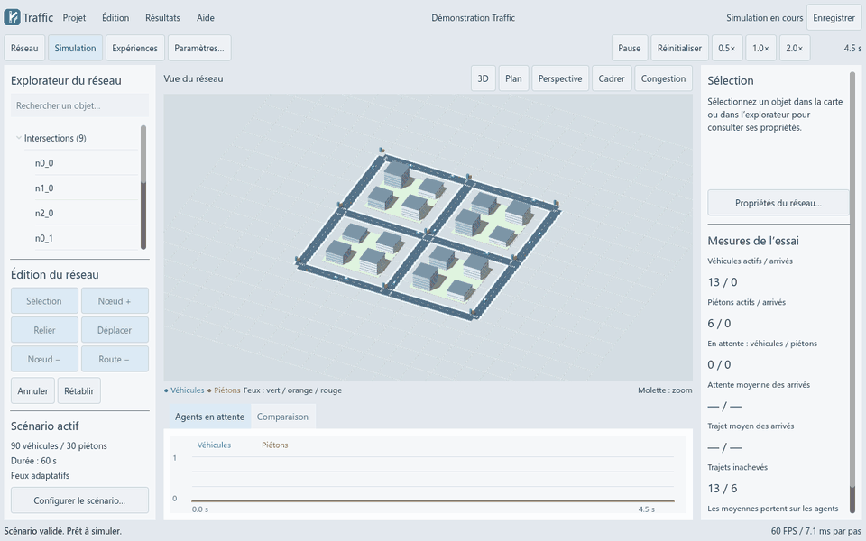
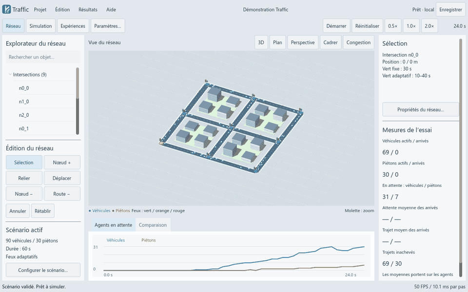
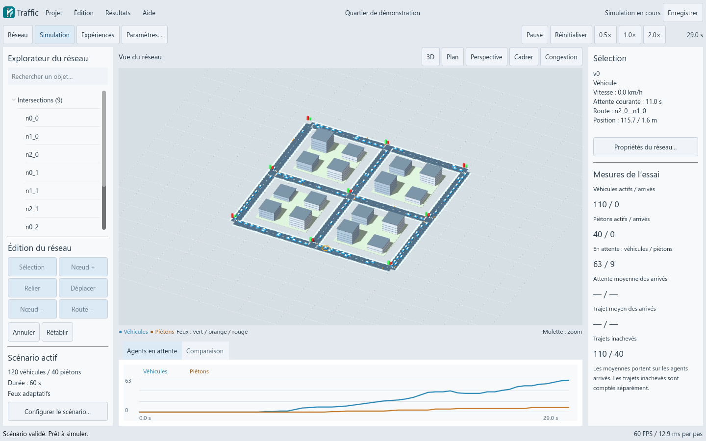
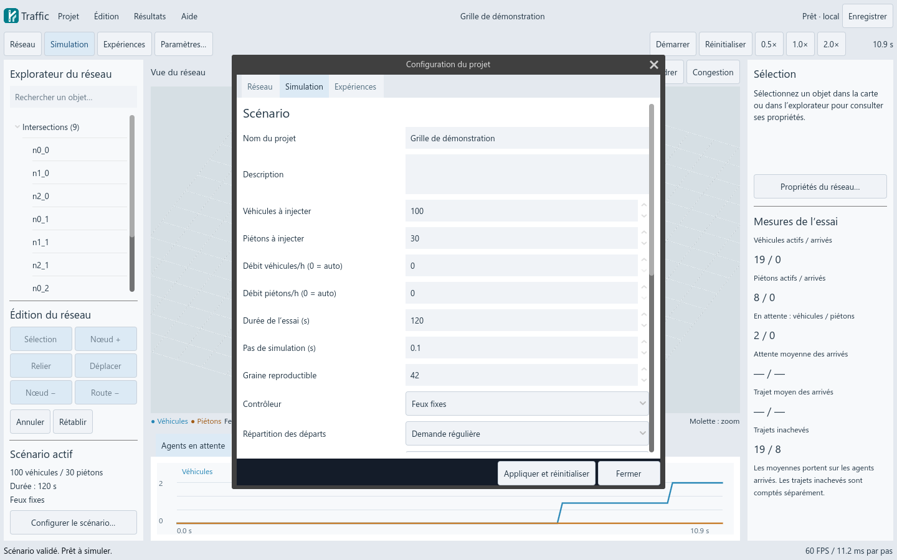
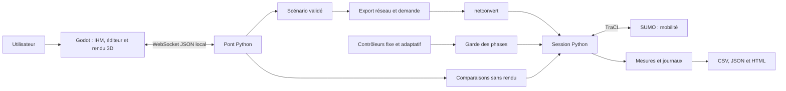

<p align="center">
  
</p>

<h1 align="center">Traffic</h1>

<p align="center">
  Un atelier de simulation de mobilité urbaine.<br>
  Construire un réseau, observer véhicules et piétons, comparer les stratégies de feux.
</p>

<p align="center">
  
  
  
  
  
</p>

<p align="center">
  <a href="#installation">Installation</a> ·
  <a href="#prise-en-main">Prise en main</a> ·
  <a href="#architecture">Architecture</a> ·
  <a href="docs/user-guide.md">Guide utilisateur</a> ·
  <a href="docs/verification.md">Validation</a>
</p>



*Capture de l’application : circulation, sélection d’un véhicule, état de ses déplacements et évolution des files d’attente. [Voir une capture fixe](docs/screenshots/studio-loaded.png).*

## Pourquoi Traffic ?

Traffic est un projet de simulation de niveau L3 qui relie un moteur de trafic à une interface 3D de bureau. Il permet de construire un quartier synthétique, de configurer sa demande de mobilité et d’examiner les effets d’un contrôle fixe ou adaptatif des intersections.

Le rendu est assuré par **Godot**, les déplacements sont simulés par **SUMO**, et **Python** orchestre les sessions, les contrôleurs et les expériences. Les résultats proviennent de la simulation ; l’interface ne les fabrique pas.

La version **1.0** fonctionne localement sur Windows x64. Le paquet portable comprend les moteurs et l’environnement Python : aucun compte ou service cloud n’est nécessaire pour l’utiliser. Le téléchargement initial des outils de développement nécessite Internet.

<details>
<summary>Sommaire complet</summary>

- [Fonctionnalités](#fonctionnalites)
- [Démonstrations](#demonstrations)
- [Installation](#installation)
- [Prise en main](#prise-en-main)
- [Raccourcis et navigation](#navigation)
- [Scénarios et configuration](#scenarios)
- [Contrôleurs et mesures](#controleurs)
- [Ligne de commande](#cli)
- [Architecture](#architecture)
- [Fichiers et données](#donnees)
- [Tests et résultats vérifiés](#tests)
- [Construire le paquet Windows](#build)
- [Documentation](#documentation)
- [Dépannage](#depannage)
- [Contribuer et faire évoluer le projet](#contribuer)
- [Licences et composants tiers](#licences)

</details>

<a id="fonctionnalites"></a>
## Fonctionnalités

| Domaine | Ce que l’application permet |
| :--- | :--- |
| **Réseau** | Ajouter, relier, déplacer et supprimer des nœuds ; supprimer des routes ; insérer un nœud sur un segment ; annuler et rétablir les modifications. |
| **Génération** | Créer une grille de 2 à 6 lignes et colonnes, avec espacement et densité routière réglables. |
| **Infrastructure** | Configurer voies, vitesses et temps de vert ; utiliser trottoirs et passages piétons générés ou déclarés. |
| **Mobilité** | Simuler véhicules et piétons, définir populations, débits, origines et destinations, demande régulière ou heure de pointe. |
| **Feux** | Exécuter un cycle fixe ou adapter la durée des verts selon les files observées et les demandes piétonnes. |
| **Événements** | Programmer une hausse de demande, une fermeture de route ou un accident ; rouvrir les routes après l’incident. |
| **Atelier 3D** | Passer du plan à la 3D ou à la perspective, inspecter un agent ou une intersection, visualiser la congestion, capturer la vue. |
| **Projets** | Enregistrer, dupliquer, importer et exporter des scénarios JSON ; retrouver les projets et reprendre un brouillon. |
| **Expériences** | Comparer les deux contrôleurs avec les mêmes conditions pour chaque graine ; lancer une campagne de résistance. |
| **Analyse** | Consulter les files d’attente et les trajets, exporter CSV/JSON, lire un rapport HTML et accéder aux journaux bruts. |

<a id="demonstrations"></a>
## Démonstrations

### Éditer un réseau

Sélection d’une intersection, déplacement, annulation, rétablissement et passage en vue de dessus. Les modifications sont locales jusqu’à leur application au moteur.



### L’atelier de simulation

L’explorateur à gauche liste les objets du réseau. La carte occupe le centre ; l’inspecteur et les mesures sont à droite. L’analyse est accessible sous la carte. Les panneaux sont redimensionnables et la configuration s’ouvre dans une fenêtre dédiée.

<details>
<summary>Voir les captures fixes de l’interface</summary>

| Simulation et inspection | Configuration du scénario |
| :---: | :---: |
|  |  |

[Vue réseau](docs/screenshots/studio-network.png) · [Affichage compact à 1100 × 740](docs/screenshots/studio-compact.png)

</details>

Les GIFs sont des captures du logiciel, hébergées dans ce dépôt. Leur fabrication est décrite dans [docs/media/README.md](docs/media/README.md).

<a id="installation"></a>
## Installation

### Utiliser le paquet Windows portable

1. Récupérer l’archive **`Traffic-1.0-Windows-x64.zip`** fournie avec une distribution du projet.
2. Extraire le dossier `Traffic` dans un emplacement où vous pouvez écrire des fichiers.
3. Ouvrir **`Traffic.exe`**.

Conserver le dossier complet : l’exécutable utilise les sous-dossiers `_internal`, `runtime`, `sumo` et `data`. Le moteur local démarre avec l’application et s’arrête à sa fermeture.

Les archives sont produites dans `dist/`, qui est exclu du dépôt Git. Une copie des sources téléchargée depuis GitHub ne contient donc pas automatiquement l’application compilée. Elle peut être reconstruite avec les étapes ci-dessous.

### Exécuter depuis les sources

**Environnement validé : Windows x64, Python 3.14.2, Godot 4.7.2 et SUMO 1.28.0.** Le package déclare Python ≥ 3.11, mais le fichier de versions verrouillées et le paquet Windows ont été validés avec Python 3.14. La compatibilité des autres environnements doit être vérifiée séparément.

Cloner ce dépôt ou télécharger ses sources, puis ouvrir PowerShell à sa racine :

```powershell
# Installer les dépendances Python/SUMO dans .venv et le package local.
.\scripts\setup.ps1

# Télécharger le moteur Godot portable dans .tools/godot.
.\scripts\install-godot.ps1

# Vérifier que SUMO et netconvert sont disponibles.
.\.venv\Scripts\python.exe -m traffic.cli doctor

# Démarrer l'application et son moteur local.
.\scripts\Launch-Traffic.ps1
```

Après installation, un double-clic sur **`Lancer Traffic.cmd`** suffit. Les outils sont installés dans le projet, sans service Windows permanent. Il n’est pas nécessaire d’activer manuellement l’environnement Python pour utiliser ces commandes.

Pour ouvrir le projet dans l’éditeur Godot :

```powershell
.\scripts\open-editor.ps1
```

Voir [l’installation détaillée](docs/installation.md) et [requirements.lock.txt](requirements.lock.txt) pour les versions exactes.

<a id="prise-en-main"></a>
## Prise en main

1. **Charger un exemple.** Ouvrir **Expériences** et choisir une ville en grille, quatre carrefours ou un scénario de congestion.
2. **Configurer la demande.** Ouvrir **Configurer le scénario**, puis régler les populations, la durée, le pas de simulation, la graine et le contrôleur.
3. **Appliquer.** Utiliser **Appliquer et réinitialiser**. Le réseau est validé, exporté vers SUMO et chargé en pause. Une erreur conserve la session précédente.
4. **Observer.** Cliquer sur **Démarrer**, puis sélectionner un véhicule, un piéton ou un carrefour. Le graphique affiche les agents actuellement en attente.
5. **Comparer.** Dans **Expériences**, choisir le nombre de graines et lancer la comparaison. Chaque graine produit un essai fixe et un essai adaptatif avec la même demande.
6. **Examiner les résultats.** Lire la comparaison sous la carte, ouvrir le rapport HTML ou exporter les mesures. Considérer les arrivées et les trajets inachevés en complément des moyennes.

Pour créer un réseau, activer **Réseau** et utiliser les outils de l’explorateur. **Paramètres > Réseau** contient le générateur de grille et les propriétés de la sélection. Les routes dessinées sont bidirectionnelles ; déplacer un nœud demande un clic sur le nœud puis un clic sur sa destination.

Le [guide utilisateur](docs/user-guide.md) détaille aussi les événements, sauvegardes et conventions d’affichage.

<a id="navigation"></a>
## Raccourcis et navigation

| Action | Commande |
| :--- | :--- |
| Démarrer / mettre en pause | `Espace`, hors d’un champ de saisie |
| Enregistrer le projet | `Ctrl+S` |
| Ouvrir un scénario JSON | `Ctrl+O` |
| Annuler / rétablir une modification du réseau | `Ctrl+Z` / `Ctrl+Y` |
| Afficher l’aide | `F1` |
| Zoomer dans la carte | Molette ou flèches haut/bas |
| Tourner la vue | Glisser avec le bouton droit ou flèches gauche/droite |
| Déplacer la vue | Glisser avec le bouton du milieu |
| Retrouver l’ensemble du réseau | **Cadrer** |
| Examiner un objet | Clic dans la carte ou dans l’explorateur |

Les vitesses **0,5× / 1× / 2×** changent la cadence réelle, pas le pas ni les résultats au même temps simulé. Réinitialiser recharge les mêmes conditions et la même graine.

<a id="scenarios"></a>
## Scénarios et configuration

Trois scénarios sont inclus :

| Fichier | Usage |
| :--- | :--- |
| [grid.json](data/scenarios/grid.json) | Découvrir une ville en grille et le rendu des déplacements. |
| [crossing_lab.json](data/scenarios/crossing_lab.json) | Étudier quatre carrefours et comparer les contrôleurs. |
| [congestion.json](data/scenarios/congestion.json) | Observer une demande plus chargée et les files d’attente. |

Les scénarios utilisent un schéma JSON versionné et validé par Pydantic. Les champs inconnus, nombres non finis et références incohérentes sont rejetés.

| Paramètre | Signification |
| :--- | :--- |
| `schema_version` | Version du format ; `1` dans cette version. |
| `seed` | Graine de génération de la demande et des itinéraires. |
| `duration`, `step_length` | Durée et pas de simulation, en secondes. |
| `vehicles`, `pedestrians` | Populations initiales à injecter ; les événements peuvent ajouter des agents. |
| `vehicle_rate`, `pedestrian_rate` | Débits explicites en agents/heure ; `null` utilise la répartition automatique. Le zéro affiché dans l’IHM correspond à cette option automatique. |
| `controller` | `fixed` ou `adaptive`. |
| `demand_profile` | `steady` ou `peak`. |
| `network` | Nœuds, routes orientées, passages piétons et génération automatique des traversées. |
| `events` | Hausses de demande et incidents programmés. |
| `*_origins`, `*_destinations` | Listes de routes d’entrée et de destination ; une liste vide laisse le choix à la génération. |

Les coordonnées sont en **mètres**, les durées en **secondes** et la vitesse d’une route dans le JSON en **m/s**. L’IHM présente les vitesses en km/h. Une route bidirectionnelle est décrite par deux arcs orientés.

Le générateur conserve un réseau fortement connecté avec au moins deux connexions par nœud : la densité réalisée peut être supérieure à la densité demandée.

Les hausses de demande ajoutent véhicules et/ou piétons. Les fermetures bloquent de nouvelles entrées sur les voies concernées et demandent un reroutage ; les accidents immobilisent aussi les véhicules concernés présents. À la réouverture, les permissions et les vitesses sont restaurées.

Les modèles complets se trouvent dans [domain/models.py](backend/src/traffic/domain/models.py). Pour un exemple importable, partir de l’un des scénarios livrés ou exporter un projet depuis l’IHM.

<a id="controleurs"></a>
## Contrôleurs et mesures

### Contrôle des feux

| Stratégie | Comportement |
| :--- | :--- |
| **Fixe** | Durée des verts véhicules configurée par intersection ; 30 s par défaut. |
| **Adaptatif** | Recommande une durée à l’entrée d’une phase en fonction des véhicules arrêtés et des demandes piétonnes. La recommandation est bornée par la politique puis par les paramètres du nœud. |

Les deux stratégies utilisent un cycle commun calculé à partir des conflits du réseau SUMO. Les traversées piétonnes disposent d’une phase dédiée. Les transitions orange, tout-rouge et dégagement sont imposées par une garde ; le contrôleur adaptatif change la durée, sans sauter arbitrairement les phases.

La règle adaptative est une **baseline expérimentale**, pas un modèle d’apprentissage ni une implémentation de Max-Pressure. Elle ne garantit pas un meilleur résultat dans chaque scénario.

### Lire les résultats

- L’attente cumulée intègre les pas pendant lesquels la vitesse est inférieure à **0,1 m/s**.
- Un arrêt correspond à une transition entre mouvement et immobilité.
- Le temps de trajet est calculé entre le départ observé et l’arrivée.
- Les moyennes d’attente et de trajet portent sur les **agents arrivés**.
- Les agents **non partis** et les **trajets inachevés** sont comptés séparément. Sans arrivée, une moyenne vaut `null`.
- Les téléportations automatiques de décongestion sont désactivées.

Une comparaison contrôle par **SHA-256** que la demande est identique pour les deux contrôleurs de chaque graine. Elle exporte les résultats individuels, les moyennes entre essais et les écarts-types. L’intervalle normal à 95 % disponible à partir de trois essais avec arrivées reste exploratoire.

Voir [les algorithmes et conventions de mesure](docs/algorithms.md) avant d’interpréter les exports. Les scénarios synthétiques et leurs plans de feux ne constituent pas une validation de trafic réel ou une certification de sécurité routière.

<a id="cli"></a>
## Ligne de commande

Le moteur peut fonctionner sans interface 3D. Exécuter les commandes depuis la racine du dépôt.

```powershell
# Vérifier les exécutables SUMO et netconvert.
.\.venv\Scripts\python.exe -m traffic.cli doctor

# Créer un nouveau scénario, sans écraser les exemples livrés.
.\.venv\Scripts\python.exe -m traffic.cli generate --rows 3 --columns 3 --scenario data/scenarios/my-grid.json

# Simuler 200 pas avec le contrôleur adaptatif.
.\.venv\Scripts\python.exe -m traffic.cli run --scenario data/scenarios/crossing_lab.json --controller adaptive --steps 200 --output data/generated/cli-demo

# Comparer fixe et adaptatif sur trois graines : six essais.
.\.venv\Scripts\python.exe -m traffic.cli compare --scenario data/scenarios/crossing_lab.json --seeds 42 43 44 --output data/results/my-comparison

# Lancer une campagne de résistance sur plusieurs charges et réseaux.
.\.venv\Scripts\python.exe -m traffic.cli stress --scenario data/scenarios/crossing_lab.json --seeds 42 --output data/results/my-stress

# Démarrer le pont local manuellement pour le développement.
.\.venv\Scripts\python.exe -m traffic.cli serve --scenario data/scenarios/grid.json --port 8765 --output data/generated/manual-session
```

`run` s’arrête au nombre de pas demandé ou à la durée du scénario. Les snapshots de cette commande sont exportés dans `data/results/demo` ; `--output` choisit son dossier de session SUMO. `compare` et `stress` placent leurs rapports dans le dossier `--output`.

Pour connecter l’IHM au pont manuel, utiliser `scripts/start-godot.ps1` dans un autre terminal. Le lancement normal par `Lancer Traffic.cmd` gère automatiquement un port libre et la fermeture du service.

<a id="architecture"></a>
## Architecture



**SUMO est la source de vérité des déplacements.** Godot interpole les positions reçues pour rendre l’animation fluide, sans changer les mesures. Les stratégies recommandent des durées ; la garde commune contrôle leur application. Les campagnes de comparaison tournent dans un processus séparé pour garder le pont réactif.

```text
Traffic/
├── backend/
│   ├── src/traffic/
│   │   ├── bridge/          # Commandes et échanges WebSocket
│   │   ├── controllers/     # Stratégies et garde des feux
│   │   ├── domain/          # Modèles de scénario et événements
│   │   ├── experiments/     # Comparaisons, résistance, rapports
│   │   ├── metrics/         # Collecte et export des mesures
│   │   ├── network/         # Génération, validation, export SUMO
│   │   ├── simulation/      # Sessions, horloge et événements
│   │   ├── storage/         # Scénarios, projets et historique
│   │   ├── cli.py           # Commandes sans interface
│   │   └── desktop.py       # Lanceur de l'application
│   └── tests/               # Tests Python
├── frontend/godot/
│   ├── assets/              # Identité et icône
│   ├── scenes/              # Scène principale
│   ├── scripts/             # IHM, éditeur, rendu et graphiques
│   └── tests/               # Recettes et captures Godot
├── data/scenarios/          # Exemples versionnés
├── docs/                    # Guides, validation, médias et licences tierces
├── scripts/                 # Installation, lancement, compilation et documentation
├── pyproject.toml           # Package Python et outils de développement
├── requirements.lock.txt    # Versions de l'environnement validé
└── Lancer Traffic.cmd       # Démarrage depuis les sources
```

Le pont manuel écoute par défaut sur `ws://127.0.0.1:8765`. Le lanceur de bureau choisit un port libre. Les messages suivent le protocole JSON version 1 ; `TRAFFIC_PORT` permet au client Godot de joindre le port choisi.

La [documentation d’architecture](docs/architecture.md) détaille les responsabilités et invariants ; le [protocole](docs/protocol.md) décrit les commandes et réponses.

<a id="donnees"></a>
## Fichiers et données

| Emplacement | Contenu |
| :--- | :--- |
| `data/scenarios/` | Exemples JSON livrés avec le projet. |
| `data/projects/` | Projets enregistrés dans la bibliothèque locale. |
| `data/generated/` | Sessions, réseaux et demandes SUMO, journaux bruts et mesures. |
| `data/results/` | Exports, comparaisons et campagnes de résistance. |
| `data/logs/` | Diagnostics du lanceur, du moteur et de l’interface. |
| `data/profile/` | Profil de l’application lorsqu’elle est lancée par le lanceur ; brouillons et captures Godot y sont conservés. |
| `.tools/`, `.venv/`, `dist/` | Outils locaux, environnement Python et paquet compilé ; exclus de Git. |

Les sessions peuvent contenir `raw.jsonl`, `summary.json`, `decisions.json`, `journeys.json` et les fichiers SUMO. Une campagne comparative produit notamment **`comparison.json`**, **`comparison.csv`** et **`report.html`**. Une campagne de résistance conserve **`stress.json`** et **`worst-scenario.json`**.

Les données sont stockées localement. Pour déplacer un projet entre installations, utiliser l’import/export JSON. Sauvegarder les projets et les résultats avant de remplacer une distribution existante.

<a id="tests"></a>
## Tests et résultats vérifiés

### Tests automatisés

```powershell
# Tests du modèle, des réseaux, de la simulation et des fonctions livrées.
.\.venv\Scripts\python.exe -m pytest -q -p no:cacheprovider

# Analyse et vérification du format Python.
.\.venv\Scripts\python.exe -m ruff check backend scripts/desktop_entry.py
.\.venv\Scripts\python.exe -m ruff format --check backend scripts/desktop_entry.py

# Recette de l'éditeur Godot, sans moteur Python.
& .\.tools\godot\Godot_v4.7.2-stable_win64_console.exe --headless --path frontend/godot --script res://tests/editor_smoke.gd
```

Pour la recette complète de l’IHM, démarrer `traffic.cli serve` sur le port 8765 dans un premier terminal, puis :

```powershell
& .\.tools\godot\Godot_v4.7.2-stable_win64_console.exe --headless --path frontend/godot --script res://tests/workflow.gd
```

Après compilation, vérifier le moteur embarqué et l’IHM exportée ensemble :

```powershell
.\.venv\Scripts\python.exe scripts/verify-portable.py
```

La validation documentée comprend **17 tests Python**, une recette d’édition, le parcours complet de l’IHM, des captures à **1440 × 900** et **1100 × 740**, des comparaisons et une campagne de résistance. Le parcours couvre aussi la sélection dans l’explorateur, la configuration, la sauvegarde, l’annulation/rétablissement, l’inspection et l’export.

### Performances observées

La refonte de l’IHM a été mesurée à environ **60 FPS**, avec un plafond de 60, sur dix secondes à **1440 × 900**, jusqu’à **110 véhicules et 40 piétons visibles**, avec une **NVIDIA RTX 2060**. Cette mesure concerne cette configuration et ce scénario.

Les valeurs brutes se trouvent dans [performance.json](docs/screenshots/performance.json).

### Exemple de comparaison

Scénario de quatre carrefours : 30 véhicules, 12 piétons, durée 180 s, pas 0,5 s, graines 42/43/44. Moyennes entre essais :

| Mesure | Fixe | Adaptatif |
| :--- | ---: | ---: |
| Véhicules arrivés | 29,33 / 30 | 29,67 / 30 |
| Piétons arrivés | 8 / 12 | 9,67 / 12 |
| Attente des véhicules arrivés | 25,07 s | 32,49 s |
| Attente des piétons arrivés | 10,15 s | 6,25 s |

Dans ce cas, l’adaptatif dessert mieux les piétons et augmente l’attente moyenne des véhicules arrivés. Ce compromis rappelle pourquoi les arrivées, les trajets inachevés et les deux populations doivent être examinés ensemble.

Le [rapport de validation](docs/verification.md) donne les conditions et les limites de ces vérifications.

<a id="build"></a>
## Construire le paquet Windows

Les dépendances sont installées par `setup.ps1`, y compris PyInstaller. Si l’environnement a été créé autrement, installer l’option de compilation avant de construire :

```powershell
.\.venv\Scripts\python.exe -m pip install '.[build]'
.\scripts\build-release.ps1
.\.venv\Scripts\python.exe scripts/verify-portable.py
.\.venv\Scripts\python.exe scripts/package-release.py
```

La construction produit `dist/Traffic/Traffic.exe` avec ses dépendances, puis l’archive `dist/Traffic-1.0-Windows-x64.zip`, son empreinte SHA-256 et un manifeste de distribution. Les données d’exécution sont exclues de l’archive par le script de packaging.

Le moteur Godot standard livré exécute un pack de ressources `runtime/traffic.pck` : les modèles d’export Godot ne sont pas nécessaires à ce mode de distribution. L’application portable n’est pas signée avec un certificat éditeur.

Pour une publication GitHub, distribuer l’archive et son fichier `.sha256` via une Release plutôt que versionner `dist/`. La publication n’est pas effectuée par les scripts de compilation.

<a id="documentation"></a>
## Documentation

| Document | Pour trouver… |
| :--- | :--- |
| [Guide utilisateur](docs/user-guide.md) | Les opérations dans l’application, événements et sauvegardes. |
| [Installation](docs/installation.md) | Les versions, prérequis et étapes d’installation. |
| [Architecture](docs/architecture.md) | Les modules, flux et invariants du système. |
| [Protocole](docs/protocol.md) | Les commandes et réponses du pont local. |
| [Algorithmes et mesures](docs/algorithms.md) | Les plans de feux, contrôleurs et conventions de calcul. |
| [Recette et périmètre](docs/acceptance.md) | Les exigences couvertes et les limites de la version. |
| [Validation](docs/verification.md) | Les tests, campagnes et résultats observés. |
| [Conception de l’IHM](docs/design.md) | L’organisation des panneaux et les décisions visuelles. |
| [Références de la refonte](docs/ui-redesign.md) | Les logiciels étudiés et la direction retenue. |
| [Médias du README](docs/media/README.md) | La génération des GIFs à partir de captures réelles. |
| [Composants tiers](docs/third-party.md) | Les dépendances, notices et licences. |
| [Contribuer](CONTRIBUTING.md) | Le parcours de contribution et les vérifications utiles. |

<a id="depannage"></a>
## Dépannage

| Situation | Vérification / action |
| :--- | :--- |
| Le lancement depuis les sources échoue | Vérifier Python x64, exécuter `setup.ps1`, puis `install-godot.ps1`. Lire les journaux dans `data/logs/`. |
| Le moteur 3D est absent | Réinstaller le dossier portable complet ou relancer `install-godot.ps1` depuis les sources. |
| SUMO ou netconvert est introuvable | Exécuter `traffic.cli doctor` avec l’interpréteur de `.venv` ; réinstaller les dépendances si nécessaire. |
| L’IHM reste en connexion avec un pont manuel | Vérifier que le serveur est démarré et que son port correspond à `TRAFFIC_PORT` ; le port par défaut est 8765. |
| Le réseau est refusé | Lire le message de validation : références, connectivité, positions, routes de longueur nulle ou croisements sans carrefour. Corriger puis appliquer. |
| Une modification ne se voit pas dans la simulation | Les changements restent locaux jusqu’à **Appliquer et réinitialiser** ou au prochain démarrage avec validation. |
| Une comparaison est refusée | Appliquer d’abord les modifications locales ; consulter le message d’erreur et les journaux si le calcul échoue. |
| Les moyennes affichent un tiret | Aucun agent du groupe n’est encore arrivé ; la moyenne n’est pas définie. Examiner les actifs et trajets inachevés. |
| Le trafic reste bloqué | Les téléportations de décongestion sont désactivées. Examiner la demande, les durées et les permissions ; un blocage peut faire partie du résultat. |
| Impossible d’enregistrer ou d’exporter | Déplacer le dossier de l’application vers un emplacement accessible en écriture. |

<a id="contribuer"></a>
## Contribuer et faire évoluer le projet

Les contributions sont décrites dans [CONTRIBUTING.md](CONTRIBUTING.md). Pour signaler un problème, joindre la version, les étapes, le scénario, la graine et les journaux utiles. Un petit scénario reproductible facilite l’analyse.

Les pistes suivantes restent **hors de la version 1.0** :

- Routes courbes et import de réseaux géographiques.
- Configuration fine des mouvements et validation de géométries importées.
- Coordination avancée des intersections et véritable stratégie Max-Pressure.
- Apprentissage par renforcement et autres stratégies de recherche.
- Transports publics et modèles de mobilité supplémentaires.
- Validation terrain et élargissement des essais de conflit et de dégagement.

Ces pistes ne sont pas des fonctionnalités déjà livrées. Le noyau et les extensions réalisées sont recensés dans [la recette](docs/acceptance.md).

<a id="licences"></a>
## Licences et composants tiers

Godot, SUMO, Python et les bibliothèques embarquées ont leurs propres licences et notices, conservées dans [docs/licenses/](docs/licenses/) et expliquées dans [docs/third-party.md](docs/third-party.md).

**Aucune licence pour le code propre de Traffic n’est actuellement définie à la racine du dépôt.** La présence de licences tierces n’attribue pas automatiquement une licence au projet ; une licence du projet doit être choisie par son auteur avant de revendiquer une distribution sous MIT, Apache ou une autre licence.

Les GIFs et captures de ce README sont réalisés à partir de Traffic. Les bâtiments du rendu donnent un contexte spatial schématique ; ils ne représentent pas une ville réelle.
