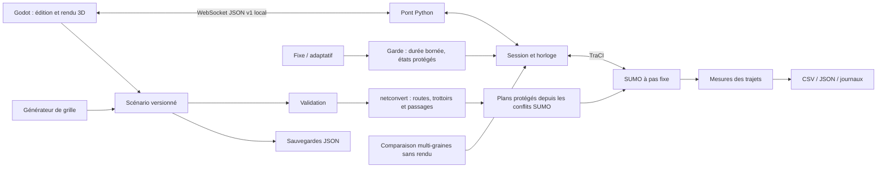

# Architecture de Traffic 1.0

Mise à jour du 12 octobre 2026 : le lanceur `traffic.desktop` démarre un service
privé sur un port libre et ferme celui-ci via une commande authentifiée à la
fermeture de l’IHM. Le paquet Windows inclut Python, SUMO et le moteur Godot
standard avec un pack de ressources. Les sessions écrivent leurs journaux bruts.

`main.gd` orchestre la connexion et les actions ; `studio_ui.gd` construit l’IHM ;
`world_view.gd` gère le monde et la caméra ; `network_editor.gd` manipule le brouillon.
`storage/catalog.py` gère la bibliothèque et l’historique, `experiments/stress.py`
les campagnes de résistance, `experiments/report.py` le rapport HTML.

Godot/GDScript : interface, éditeur et rendu. Python : modèle et orchestration.
SUMO/TraCI : source de vérité de la mobilité. Windows x64, fonctionnement local.

| Module | Responsabilité |
|---|---|
| `frontend/godot/scripts/main.gd` | Contrôles, rendu, feux, piétons et liaison locale |
| `network_editor.gd` | Modifications locales et historique d’annulation |
| `metrics_chart.gd` | Courbes d’attente en temps simulé |
| `backend/src/traffic/domain` | Modèles Pydantic versionnés et événements |
| `network` | Grille, validation, export SUMO et plans protégés |
| `controllers` | Contrat de stratégie, fixe/adaptatif et garde |
| `simulation` | Session SUMO, abonnements d’états, événements et horloge |
| `metrics` | Trajets, attentes, arrêts et exports |
| `experiments` | Comparaisons identiques et agrégation multi-graines |
| `bridge` | Commandes validées, diffusion et comparaison en processus séparé |
| `storage` | Lecture validée et écriture locale par remplacement |
| `data/scenarios` | Scénarios réutilisables |

## Invariants

Godot ne calcule pas la physique des déplacements. Un lissage visuel des positions
reçues évite les sauts ; il ne modifie aucun résultat de simulation. Le temps avance
par pas fixes ; les vitesses 0,5x/1x/2x règlent seulement la cadence réelle.
Les abonnements TraCI limitent le nombre de requêtes individuelles par agent.

Les stratégies recommandent des durées. Seul l’adaptateur protégé communique avec
TraCI. Les phases restent dans un cycle sans conflits ; orange et tout-rouge ne
peuvent pas être abrégés par les stratégies. Une occupation persistante prolonge
le dégagement. Voir les limites du modèle dans `algorithms.md`.

Le scénario est validé et exporté dans une nouvelle session avant de remplacer
l’ancienne. Une modification ne s’applique pas en cours de simulation ; elle
réinitialise le scénario. Le reset recharge les mêmes paramètres et la même graine.
Un seul scénario est partagé entre les clients locaux.

Coordonnées en mètres : SUMO `(x,y)` devient Godot `(x, altitude, -y)` ; l’angle
SUMO est converti en rotation `-angle` autour de Y. La normalisation de coordonnées
netconvert est désactivée pour conserver les coordonnées du projet.

## Expériences

Le processus de comparaison n’utilise aucun rendu. Chaque graine fournit deux
essais avec carte, demande, événements, durée et pas identiques. Le fichier de
demande est contrôlé par empreinte ; les résultats séparent arrivés, non partis
et trajets inachevés. Les versions et décisions sont documentées dans les exports.
Les comparaisons déclenchées dans Godot sont lancées dans un processus séparé pour
garder le pont réactif. Chaque campagne et export de l’interface a son dossier.

## Périmètre restant

Le réseau manuel est volontairement simple ; les passages peuvent être spécifiés
dans le modèle ou générés par SUMO. Les bornes de vert sont configurables par nœud.
La configuration fine des mouvements, la gestion complète des conflits des réseaux
importés, les courbes, Max-Pressure véritable, la coordination et les extensions RL
constituent les prochaines étapes. Les fermetures, incidents et campagnes de
résistance sont implémentés. Le benchmark documenté dépasse la cible 30 FPS sur
la machine testée. Aucune validation de trafic réel n’est revendiquée.
